# 11 · Manual de uso del panel

> Para el equipo de Reconstruyendo Esperanza. Explica cómo entrar al panel y publicar desde el celular. Las imágenes muestran datos de prueba `[DEMO]`; en el sitio real verás los tuyos.
>
> Las capturas se generan solas con `npm run docs:manual` (paso 10.4): cuando cambien las pantallas, se vuelven a tomar.

**Dirección del panel:** `https://[PENDIENTE: dominio]/admin`

---

## 1. Antes de empezar: los roles

Cada persona tiene un rol. El panel solo muestra lo que tu rol puede hacer.

| Rol | Qué puede hacer |
|---|---|
| **Autor** | Crea contenido y sube fotos; lo **envía a revisión**. No publica. |
| **Editor** | Revisa, **publica** y gestiona el contenido, las fotos, las autorizaciones de imagen y los mensajes de contacto. |
| **Administrador** | Todo lo del Editor, y además: usuarios, configuración del sitio, auditoría y papelera. |

## 2. Entrar al panel

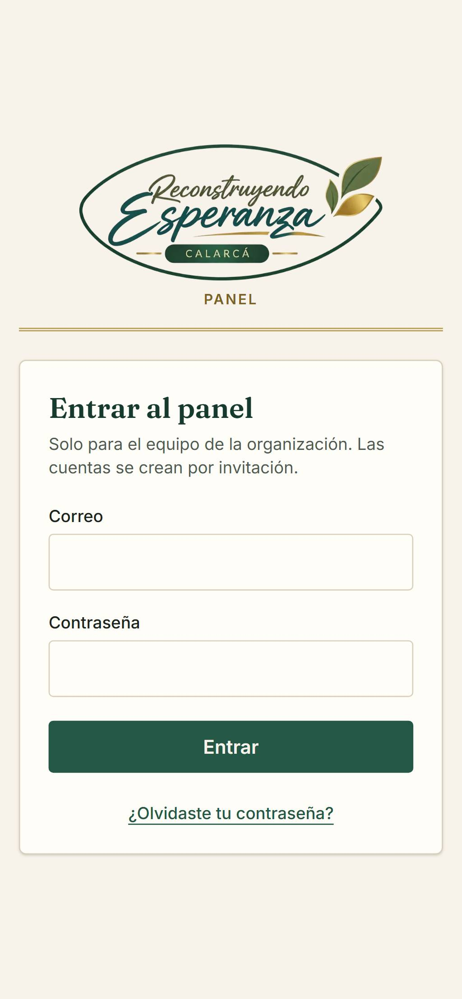

1. Abre la dirección del panel en el celular o el computador.
2. Escribe tu **correo** y tu **contraseña** y pulsa **Entrar**.
3. Escribe el **código de 6 números** que muestra tu app autenticadora.

**¿Olvidaste tu contraseña?** Pulsa ese enlace en la pantalla de entrada, escribe tu correo y sigue el enlace que te llega.

### La primera vez: proteger tu cuenta

Te llega un correo de invitación. Al abrirlo creas tu contraseña (mínimo 12 caracteres; una frase es más fácil de recordar) y luego el panel te pide **proteger tu cuenta**:

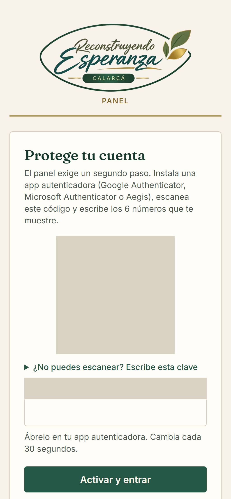

1. Instala en tu celular una app autenticadora: **Google Authenticator**, **Microsoft Authenticator** o **Aegis**.
2. En la app, toca **agregar cuenta** y **escanea el código** que muestra el panel. (Si no puedes escanear, toca *¿No puedes escanear? Escribe esta clave* y cópiala en la app).
3. Escribe los 6 números que te muestra la app y pulsa **Activar y entrar**.

Desde ahí, cada vez que entres te pedirá el código de la app. **Si pierdes o cambias el celular**, avisa a un Administrador: él restablece tu verificación (sección 8) y la vuelves a configurar.

## 3. El inicio del panel

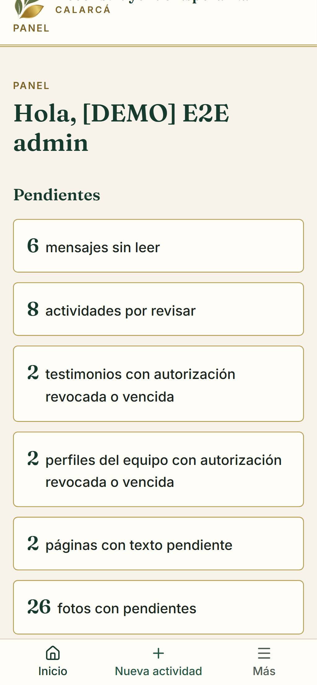

Muestra lo que está **pendiente** (actividades por revisar, fotos sin describir, mensajes sin leer). En el celular, abajo tienes **Inicio**, **Nueva actividad** y **Más** (todo el menú).

## 4. Publicar una actividad desde el celular

Toca **Nueva actividad**. Son 4 pasos; lo que escribes **se guarda solo**, incluso si se va la señal (al volver, el panel te ofrece recuperar lo escrito).

### Paso 1 · Lo básico

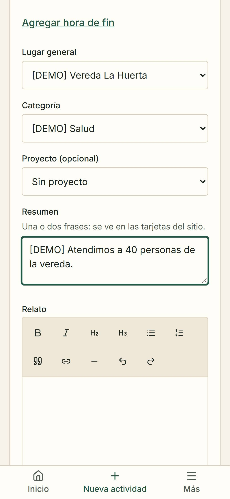

Título, fecha, hora de inicio (y de fin, si quieres), **lugar general** (vereda o barrio, nunca una dirección), categoría y un resumen corto. El relato completo es opcional. Pulsa **Siguiente**.

### Paso 2 · Fotos

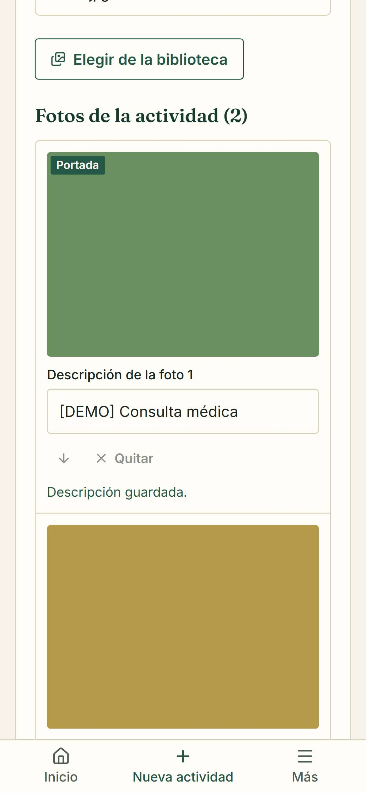

1. Toca **Tomar o elegir fotos** (puedes tomarlas en el momento o elegirlas de la galería) o **Elegir de la biblioteca** si ya estaban subidas.
2. Escribe una **descripción** en cada foto: es lo que escuchan las personas ciegas y lo que lee Google. Describe lo que se ve («Consulta médica en el salón comunal»), no el nombre del archivo.
3. La primera foto es la **portada**; puedes cambiarla. Con las flechas cambias el orden y con **Quitar** la sacas.

Las fotos se suben sin la ubicación GPS ni los datos de la cámara (el panel los borra).

### Paso 3 · Personas en las fotos

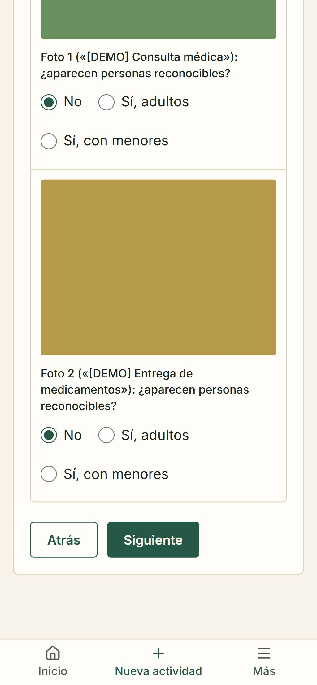

En cada foto marca si aparecen personas **reconocibles**: **No**, **Sí, adultos** o **Sí, con menores**.

- Si hay personas, cada una necesita su **autorización de imagen** firmada. Toca **Vincular autorización** para elegir una ya registrada o **Registrar una nueva** ahí mismo (sección 5).
- Con menores, la autorización la firma el **representante legal** y se registra la opinión del menor.
- Al final confirma que todas las personas están cubiertas.

**Una foto con personas sin autorización no se publica.** El panel no lo permite.

### Paso 4 · Revisar y publicar

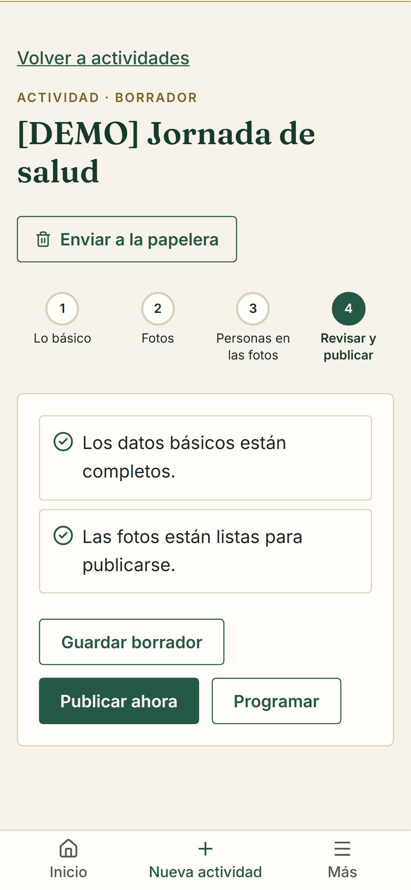

La lista muestra si todo está listo. Si algo falta, dice qué foto y qué hacer, con un enlace **Resolver**.

- **Editor o Administrador:** **Publicar ahora**, o **Programar** para que aparezca sola en una fecha y hora.
- **Autor:** **Enviar a revisión**; un Editor la revisa y la publica (o te la devuelve con una nota).

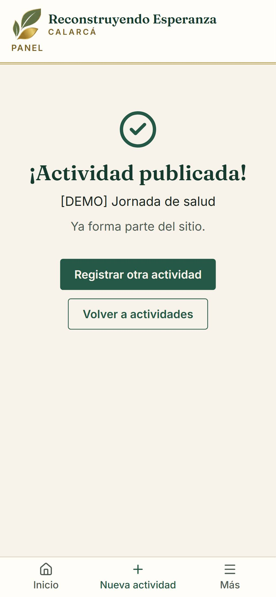

Listo: la actividad ya está en el sitio, con sus fotos. Desde ahí puedes **Registrar otra actividad**.

> **Historias, proyectos, galerías y videos** (menú **Contenido**) funcionan igual: escribir, agregar fotos, revisar y publicar.

## 5. Autorizaciones de imagen

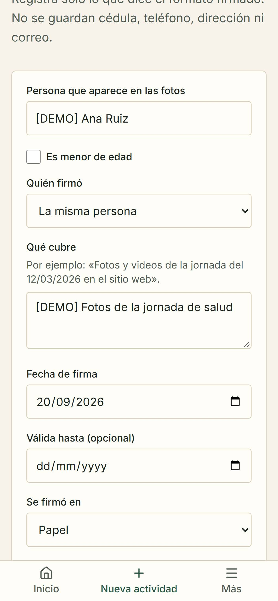

Menú **Más → Autorizaciones → Registrar autorización**:

1. Nombre de la persona que aparece; si es **menor de edad**, márcalo y escribe el nombre del representante legal.
2. **Qué cubre** (por ejemplo, «Fotos de la jornada de salud del 20 de septiembre»), fecha de firma y versión del formato.
3. **Foto del formato firmado** (una foto clara del papel). Se guarda en privado: nunca se publica.

Si una persona **revoca** su autorización, ábrela, pulsa **Revocar autorización** y confirma con **Sí, revocar**: sus fotos salen del sitio solas.

## 6. Mensajes de contacto

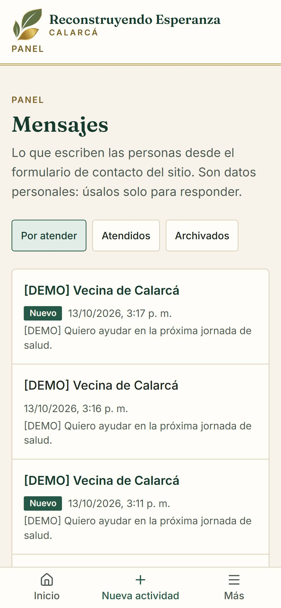

Menú **Más → Mensajes**. Las pestañas **Por atender**, **Atendidos** y **Archivados** ordenan la bandeja.

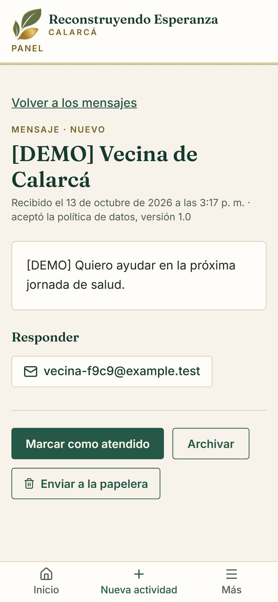

Al abrir un mensaje puedes **responder por correo, WhatsApp o teléfono** (los botones abren tu app) y luego **Marcar como atendido**. Los mensajes se borran solos 12 meses después de atendidos (política de datos): no hace falta borrarlos a mano.

## 7. Fotos (biblioteca de medios)

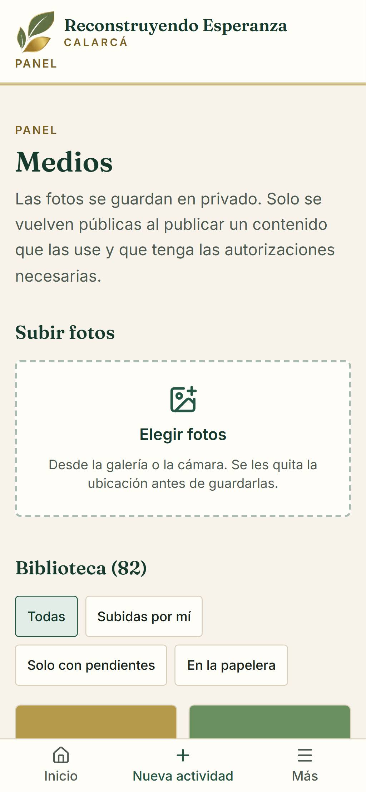

Menú **Más → Medios**: todas las fotos subidas, con avisos de las que **les falta descripción** o **autorización**. Si una foto quedó a medias (se cerró la app mientras subía), aparece con **Reintentar** o **Quitar**; si nadie hace nada, el sistema la retira solo en uno a siete días.

## 8. Papelera, usuarios y configuración (Administrador)

### Papelera

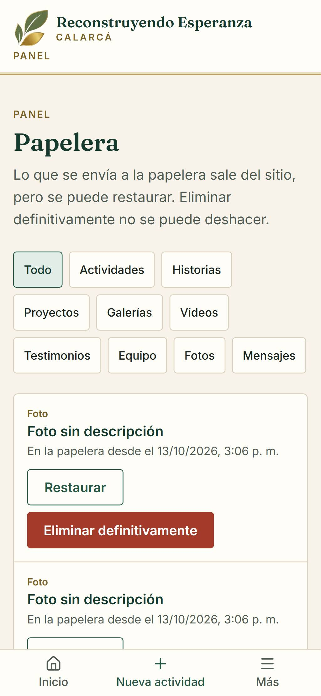

Lo que se envía a la papelera **sale del sitio de inmediato**. Desde aquí el Administrador lo **Restaura** (vuelve como borrador) o lo **Elimina definitivamente** escribiendo `ELIMINAR` para confirmar. Eliminar no se puede deshacer. La papelera no se vacía sola.

### Usuarios

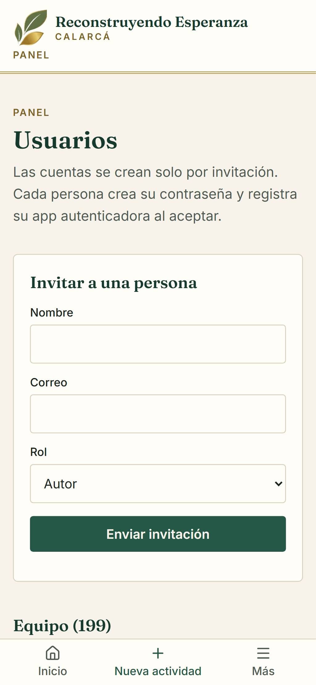

- **Invitar a una persona:** nombre, correo y rol → **Enviar invitación**. La persona recibe el correo y crea su contraseña y su verificación.
- **Cambiar rol** o **Desactivar** (la persona ya no puede entrar; se puede **Reactivar**).
- **Restablecer verificación:** cuando alguien pierde o cambia el celular. Pide confirmación y queda en la auditoría. **Si el celular se perdió o lo robaron, desactiva también la cuenta** mientras tanto.
- Nadie puede cambiar su propio rol, desactivarse ni restablecer su propia verificación: lo hace otro Administrador. Por eso siempre debe haber **al menos dos Administradores**.

### Configuración del sitio

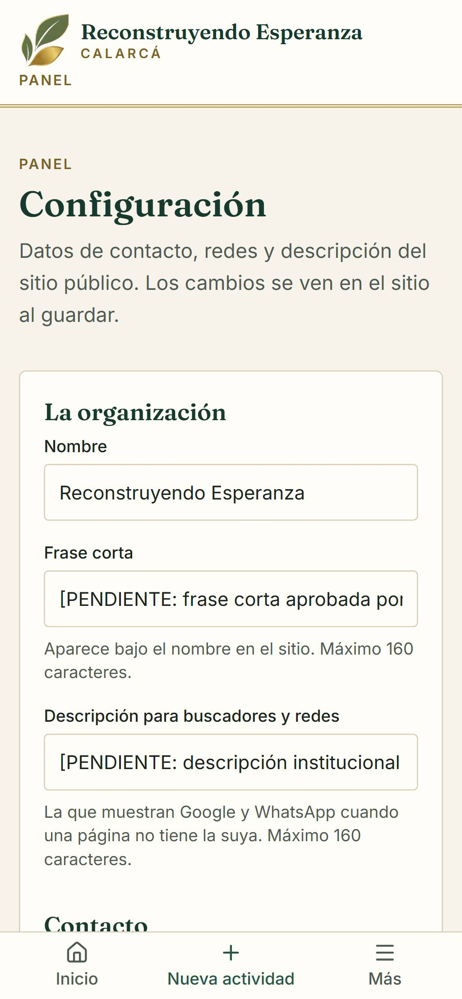

Datos de contacto, WhatsApp, redes sociales y textos institucionales que se ven en todo el sitio. Los cambios se ven en el sitio al guardar.

## 9. Tareas del Administrador técnico

| Cuándo | Qué |
|---|---|
| **Cada mes** | Revisar el espacio de las fotos en Supabase (*Storage* y *Usage*): si pasa de 800 MB o de 4 GB de transferencia al mes, avisar para pasar las fotos a R2 (`docs/03` §6.1). |
| **Cada mes** | Abrir **Auditoría** y revisar que no haya cambios extraños. |
| **Cada 3 meses** | Probar la restauración de un respaldo (paso 9.4). |
| **Cada 6 meses** | Revisar el plan de incidentes (carpeta privada): contactos y accesos al día. |
| **Si algo sale mal** | Seguir el **plan de incidentes** (carpeta privada). |

## 10. Buenas prácticas

- **Nunca** compartas tu contraseña ni el código de la app; nadie del equipo te los va a pedir.
- Publica solo fotos de personas con **autorización firmada**; ante la duda, no la publiques.
- Escribe descripciones de fotos que sirvan a alguien que no puede verlas.
- El lugar es **general** (vereda o barrio): nunca direcciones ni datos de contacto de las personas.
- Si ves algo raro en el panel o en el sitio, avisa al Administrador técnico.
